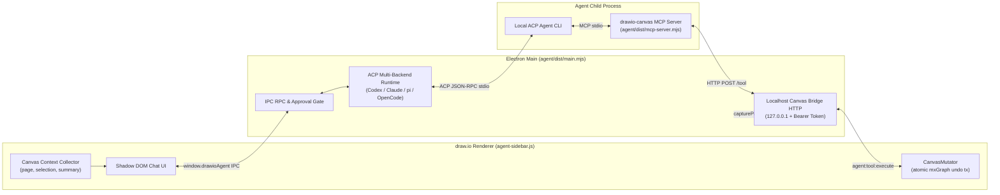

# DioSidecar

English | [简体中文](./README.zh-CN.md)

**An AI agent sidebar for drawing in draw.io Desktop.** DioSidecar is an independent project based on `drawio-desktop v32.7.4`.

Chat with **Codex**, **Claude Code**, **OpenCode**, **pi** or a custom **ACP** agent beside your diagram. The agent can read the current page and selection, edit the live canvas and record each edit as one native `Cmd+Z` / `Ctrl+Z` undo step.

---

## Key Features

- **Native Embedded Sidebar**: Right-docked, resizable Shadow DOM sidebar integrated directly into draw.io Desktop with automatic Light/Dark theme synchronization and full keyboard/clipboard isolation (`ui.keyHandler.isEnabledForEvent`).
- **Bring Your Own Local Agent (ACP)**: Connects over [Agent Client Protocol (ACP)](https://agentclientprotocol.com/) to locally installed agents — **Codex**, **Claude Code**, **OpenCode**, **pi**, or any custom ACP-compatible command. Reuses your existing local CLI sign-in or stores API keys with Electron `safeStorage` when secure system storage is available.
- **Live In-Memory Canvas Editing + Single-Step Undo**: Every mutation (`update_cells`, `insert_xml`, `insert_mermaid`, `delete_cells`) runs inside one atomic `model.beginUpdate() / endUpdate()` transaction — press `Cmd+Z` / `Ctrl+Z` (or click the inline Undo bar) to revert cleanly.
- **Built-in Canvas MCP Server (`drawio-canvas`)**:
  - Automatic XML repair, semantic role shorthand (`role=step|decision|start|end|error|data|external|container`), container/edge normalization, and offline **ELK** auto-layout.
  - **Mermaid → Native Shapes**: Converts Mermaid diagrams directly into editable draw.io vector shapes.
  - **Offline Shape Search**: Search AWS, Azure, GCP, Kubernetes, Cisco, UML, and flowchart icons locally via `search-index.json`.
  - **Visual Self-Check**: Captures a live PNG viewport snapshot via Electron `webContents.capturePage()` so multimodal agents can inspect for overlapping labels or crossing edges.
- **Safety Approval Gate**: Configurable mutation policy (`confirm-destructive` by default, `confirm-all`, or `auto`) prompts for confirmation before deleting cells or replacing an entire page.
- **Pinned editor source**: The build adds a loader hook to the pinned `drawio` submodule and bundles the sidebar plugin.

---

## Architecture



---

## Prerequisites

- **Node.js** `>= 22.12.0`, available on your login shell `PATH`. Development and CI use Node.js 26 LTS.
- **Git** (with submodule support)
- At least one local ACP-compatible agent CLI (sign in using its CLI, or configure an API key in sidebar Settings):
  - **Codex**: `npm i -g @openai/codex && codex login`
  - **Claude Code**: install `claude` and sign in via `/login`
  - **OpenCode**: `npm i -g opencode-ai && opencode auth login`
  - **pi**: `npm i -g @earendil-works/pi-coding-agent`
  - Or any custom ACP command under **Settings → Agent**

---

## Quick Start

### 1. Clone with the `drawio` submodule

```bash
git clone --recurse-submodules https://github.com/DieDiDi/diosidecar.git
cd diosidecar
```

If you already cloned without `--recursive`:

```bash
git submodule update --init --recursive
```

### 2. Install dependencies & build the Agent

```bash
npm run setup
```

This runs:
1. `npm ci` (locked Electron and desktop dependencies)
2. `npm --prefix agent ci` (Agent & Canvas MCP dependencies)
3. `npm run build:agent` (bundles `agent/dist/main.mjs`, `agent/dist/mcp-server.mjs`, `drawio/src/main/webapp/plugins/agent-sidebar.js`, and automatically hooks `drawio/src/main/webapp/js/PostConfig.js`)

### 3. Launch DioSidecar

```bash
npm start
```

> On macOS, you can also double-click `agent/launch-drawio-agent.command` for a one-click dev launch.

For development with inline sourcemaps:

```bash
npm run dev
```

### 4. Try editing the canvas

1. Create a blank diagram and open the **Agent** sidebar from the toolbar.
2. Select an agent you have signed into under **Settings → Agent**. Ask it to draw three connected nodes labeled Start, Process and Finish.
3. Check that the shapes are editable and try undoing the edit with `⌘Z` or `Ctrl+Z`. Save the result as a `.drawio` file and reopen it to check your changes.

## Privacy and permissions

- The sidebar runs the local agent CLI for your selected model. Prompts, diagram context, selections and screenshots can be sent to that model provider. Follow the provider's policies when working with sensitive diagrams.
- The app saves chat history in its local data directory. The screenshot tool can keep temporary PNG files in the system temporary directory. Use redacted examples when reporting an issue.
- The app encrypts saved API keys with Electron `safeStorage` when secure system storage is available. If it is unavailable, use the agent CLI's own sign-in flow. Only configure custom ACP executables you trust to run with your user permissions.

## Packaging and releases

GitHub Actions can build previews for Apple Silicon macOS and Windows x64. See the [build and release guide](doc/BUILDING_FOR_PERSONAL_USE.md) for downloads, installer checks and release steps. Preview builds are unsigned.

---

## Keyboard Shortcuts

| Action | macOS | Windows / Linux |
| --- | --- | --- |
| Toggle Agent Sidebar | `Cmd + Option + L` | `Ctrl + Alt + L` |
| Trigger Pinned Prompt / Skill 1–4 | `Cmd + Ctrl + 1..4` | `Ctrl + Alt + 1..4` |
| Undo Last Agent Canvas Edit | `Cmd + Z` | `Ctrl + Z` |

You can also open the sidebar from the top toolbar **Agent** button or **Extras → Agent 侧栏 (⌘⌥L)**.

---

## Canvas MCP Tools (`drawio-canvas`)

| Tool | Type | Description |
| --- | --- | --- |
| `get_diagram_summary` | Read | Active file/page info, selection, and compact summary of up to 50 cells |
| `get_cells_detail` | Read | Full label/HTML, style string, geometry, parent, and endpoints for given cell IDs |
| `search_shapes` | Read | Offline search across AWS/Azure/GCP/K8s/Cisco/UML/flowchart stencils |
| `get_drawio_reference` | Read | Official authoring docs (`design`, `xml`, `mermaid`, `styles`) on demand |
| `inspect_canvas_image` | Read | Live viewport PNG snapshot (`capturePage`) for visual self-check |
| `update_cells` | Write | Targeted in-place label, style patch, or geometry edits (1 undo step) |
| `insert_xml` | Write | Repair + shorthand expand + normalize + optional offline ELK layout + insert |
| `insert_mermaid` | Write | Convert Mermaid code directly into native editable draw.io shapes |
| `delete_cells` | Write* | Delete cells (and optionally connected edges) in 1 undo step |
| `select_and_focus` | UI | Select and scroll specific cells into view on the live canvas |

*\*Destructive operations (`delete_cells` and `replaceCurrentPage: true`) prompt for user approval by default.*

---

## Project Structure

```text
.
├── agent/                          # Embedded Agent & Canvas MCP source
│   ├── build.mjs                   # Unified esbuild bundler + drawio PostConfig.js auto-hook
│   ├── core/                       # ACP runtime, Shadow DOM chat UI, i18n (adapted from zotero-mcp)
│   ├── drawio/                     # draw.io sidebar mount, PanelHost, CanvasMutator, ContextCollector
│   ├── main/                       # Electron Main IPC, Node spawner, localhost bridge, JSONL store
│   ├── mcp/                        # Stdio Canvas MCP server & offline ELK layout pass
│   ├── shared/                     # XML repair/shorthand/normalization & offline shape search index
│   ├── skills/                     # System brief & draw.io XML/Mermaid/style reference docs
│   ├── electron-builder-mac-local.json
│   └── launch-drawio-agent.command
├── drawio/                         # Upstream jgraph/drawio submodule (v32.7.4)
├── src/main/                       # Electron main process and preload based on drawio-desktop
├── THIRD_PARTY_NOTICES.md          # Upstream attributions and license summary
└── LICENSE                         # GPL license for the host and original contributions
```

---

## Credits & License

DioSidecar uses code and assets from these projects.

- [jgraph/drawio-desktop](https://github.com/jgraph/drawio-desktop) (`GPL-3.0-only`) — Native Electron desktop app
- [jgraph/drawio](https://github.com/jgraph/drawio) (`Apache-2.0`) — Core diagram editor & `mxGraph` engine
- [Zotero Agent plugin](https://github.com/54yyyu/zotero-mcp/tree/main/plugin) (`AGPL-3.0-or-later`) — ACP runtime and chat sidebar
- [jgraph/drawio-mcp](https://github.com/jgraph/drawio-mcp) (`Apache-2.0`) — Diagram XML pipeline, offline shape index, ELK layout & authoring guides

See [THIRD_PARTY_NOTICES.md](./THIRD_PARTY_NOTICES.md) for full attribution details.
The desktop host and original contributions use the [GNU GPL v3](LICENSE). Adapted AGPL and Apache 2.0 components retain their original terms and notices.
