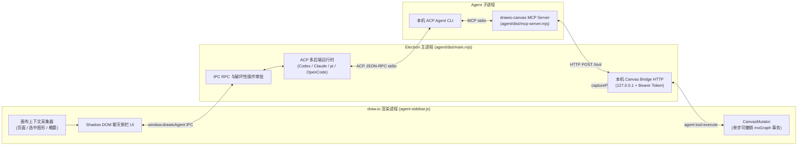

# DioSidecar

[English](./README.md) | 简体中文

**基于 draw.io Desktop 的 AI 绘图侧栏。** DioSidecar 是独立项目，基于 `drawio-desktop v32.7.4`。

无需切换到网页版、无需在磁盘外修改 `.drawio` 文件再重载——你可以一边手动拖拽编辑图表，一边在右侧与本机已有的 Agent（**Codex**、**Claude Code**、**OpenCode**、**pi** 或任意自定义 **ACP** Agent）实时对话。Agent 可以直接感知当前页面与选中图形、在内存中精准修改画布，并且每一次修改都作为单步原生 `⌘Z` / `Ctrl+Z` 撤销记录。

---

## 核心特性

- **原版桌面端内嵌侧栏**：基于 Shadow DOM 实现右侧可拖拽调宽侧栏，自动同步浅色 / 深色主题，并通过 `ui.keyHandler.isEnabledForEvent` 完整隔离输入框键盘与剪贴板事件，不干扰画布快捷键。
- **连接本机已有 Agent（ACP 协议）**：通过 [Agent Client Protocol (ACP)](https://agentclientprotocol.com/) 接入本机已安装的 **Codex**、**Claude Code**、**OpenCode**、**pi** 或任意自定义 ACP 命令；默认复用你现有的本机 CLI 订阅登录，也支持在系统安全存储可用时加密保存 API Key。
- **内存级实时画布编辑 + 单步原生撤销**：所有画布写入（`update_cells`、`insert_xml`、`insert_mermaid`、`delete_cells`）均封装在单个 `model.beginUpdate() / endUpdate()` 事务中，支持 `⌘Z` / `Ctrl+Z` 或侧栏顶部按钮一键撤销与图形定位。
- **内置画布 MCP 服务（`drawio-canvas`）**：
  - 自动执行 XML 修复、语义角色简写展开（`role=step|decision|start|end|error|data|external|container`）、容器/连线规范化与离线 **ELK** 自动布局。
  - **Mermaid 直转原生图形**：将 Mermaid 代码直接转换为可编辑的 draw.io 矢量节点与连线。
  - **离线图标库检索**：内置 `search-index.json`，离线检索 AWS、Azure、GCP、Kubernetes、Cisco、UML、流程图等官方图形样式。
  - **视觉自查**：通过 Electron `webContents.capturePage()` 实时截取画布 PNG 快照，供多模态 Agent 检查文字重叠或连线交叉。
- **安全审批机制**：支持配置修改确认策略（默认 `confirm-destructive`，删除图形或整页替换前弹出审批卡片；也可切换 `confirm-all` 或 `auto`）。
- **基于固定的上游版本**：构建会把侧栏插件注入固定版本的 `drawio` 子模块。

---

## 系统架构



---

## 环境准备

- **Node.js** `>= 22.12.0`，开发和 CI 使用 Node.js 26 LTS。请确保登录 shell 的 `PATH` 可以找到 `node`。
- **Git**（支持子模块）
- 本机至少安装并登录一个支持 ACP 的 Agent CLI（或在侧栏设置中配置 API Key）：
  - **Codex**：`npm i -g @openai/codex && codex login`
  - **Claude Code**：安装 `claude` 并在终端运行 `/login`
  - **OpenCode**：`npm i -g opencode-ai && opencode auth login`
  - **pi**：`npm i -g @earendil-works/pi-coding-agent`
  - 或在侧栏 **设置 → 智能体** 中配置任意自定义 ACP 命令

---

## 快速开始

### 1. 克隆仓库（包含 `drawio` 子模块）

```bash
git clone --recurse-submodules https://github.com/DieDiDi/diosidecar.git
cd diosidecar
```

如果克隆时未加 `--recursive`，请补拉子模块：

```bash
git submodule update --init --recursive
```

### 2. 一键安装依赖并构建 Agent

```bash
npm run setup
```

该命令会依次执行：
1. `npm ci`（按锁文件安装 Electron 与桌面应用依赖）
2. `npm --prefix agent ci`（安装 Agent 与 Canvas MCP 依赖）
3. `npm run build:agent`（构建 `agent/dist/main.mjs`、`agent/dist/mcp-server.mjs`、`drawio/src/main/webapp/plugins/agent-sidebar.js`，并自动为 `drawio/src/main/webapp/js/PostConfig.js` 注入插件加载钩子）

### 3. 启动 DioSidecar

```bash
npm start
```

> macOS 下也可以直接双击 `agent/launch-drawio-agent.command` 一键启动开发版。

如需开发调试（附带 inline sourcemap）：

```bash
npm run dev
```

### 4. 试一次画布编辑

1. 新建一个空白图表，从工具栏打开 **Agent** 侧栏。
2. 在 **设置 → 智能体** 选择已登录的 Agent。输入「画三个节点，依次连接：开始、处理、结束」。
3. 确认画布上出现了可编辑的形状，再用 `⌘Z` 或 `Ctrl+Z` 撤销一次。可重新编辑、保存为 `.drawio` 并重开。

## 隐私与权限

- 侧栏通过本机 Agent CLI 访问你选择的模型。提示词、图表上下文、选区信息和截图可能随请求传给该模型服务。请按模型服务的政策处理敏感图表。
- 会话保存在应用的本地数据目录，截图工具可能把临时 PNG 保存到系统临时目录。提交问题时请使用脱敏样例。
- 系统安全存储可用时，应用使用 Electron `safeStorage` 加密保存 API Key。安全存储不可用时，使用 Agent CLI 自己的登录方式。自定义 ACP 命令以当前用户权限运行，请选择可信的可执行文件。

## 打包与发布

GitHub Actions 提供 macOS Apple Silicon 和 Windows x64 的预览构建。下载、安装包验证和发布步骤见 [构建与发布指南](doc/BUILDING_FOR_PERSONAL_USE.md)。预览安装包尚无发行签名。

---

## 快捷键

| 功能 | macOS | Windows / Linux |
| --- | --- | --- |
| 打开 / 收起 Agent 侧栏 | `Cmd + Option + L` | `Ctrl + Alt + L` |
| 触发固定快捷提示词 / 技能 1–4 | `Cmd + Ctrl + 1..4` | `Ctrl + Alt + 1..4` |
| 撤销 Agent 上一步画布修改 | `Cmd + Z` | `Ctrl + Z` |

也可以通过顶部工具栏的 **Agent** 按钮或菜单栏 **Extras → Agent 侧栏 (⌘⌥L)** 打开侧栏。

---

## 内置画布 MCP 工具（`drawio-canvas`）

| 工具名 | 类型 | 说明 |
| --- | --- | --- |
| `get_diagram_summary` | 只读 | 读取当前文件/页面信息、选中图形及最多 50 个图形元素的概要 |
| `get_cells_detail` | 只读 | 读取指定 cell ID 的完整文本/HTML、样式、坐标尺寸、父子与连线端点 |
| `search_shapes` | 只读 | 离线检索 AWS / Azure / GCP / K8s / Cisco / UML / 流程图等图形样式 |
| `get_drawio_reference` | 只读 | 按需获取官方绘图规范文档（`design` / `xml` / `mermaid` / `styles`） |
| `inspect_canvas_image` | 只读 | 截取当前画布视口 PNG 快照（`capturePage`）用于视觉自查 |
| `update_cells` | 写入 | 就地修改指定图形的文案、样式键值或尺寸位置（单步撤销） |
| `insert_xml` | 写入 | 自动执行 XML 修复、角色简写展开、规范化与可选离线 ELK 自动排版后插入 |
| `insert_mermaid` | 写入 | 将 Mermaid 代码直接转换为原生可编辑的 draw.io 矢量图形 |
| `delete_cells` | 写入* | 删除指定图形（可选同时删除关联连线），单步撤销 |
| `select_and_focus` | 视图 | 在当前画布中选中并滚动定位到指定图形 |

*\*破坏性操作（`delete_cells` 以及 `replaceCurrentPage: true`）默认会触发侧栏审批卡片，经确认后才执行。*

---

## 目录结构

```text
.
├── agent/                          # 内嵌 Agent 与画布 MCP 源码
│   ├── build.mjs                   # 统一 esbuild 打包脚本 + 自动挂钩 drawio PostConfig.js
│   ├── core/                       # ACP 运行时、Shadow DOM 聊天 UI 与多语言（改自 zotero-mcp）
│   ├── drawio/                     # 侧栏挂载、PanelHost、CanvasMutator、上下文采集
│   ├── main/                       # Electron 主进程 IPC、进程管理、本机 Bridge、JSONL 会话存储
│   ├── mcp/                        # Stdio Canvas MCP Server 与离线 ELK 自动布局
│   ├── shared/                     # XML 修复/简写展开/规范化与离线图形检索索引
│   ├── skills/                     # 系统指令与 draw.io XML/Mermaid/样式参考文档
│   ├── electron-builder-mac-local.json
│   └── launch-drawio-agent.command
├── drawio/                         # 上游 jgraph/drawio 子模块（v32.7.4）
├── src/main/                       # 基于 drawio-desktop 的主进程与 preload
├── THIRD_PARTY_NOTICES.md          # 上游开源项目致谢与协议说明
└── LICENSE                         # GPL 主机及项目贡献的许可
```

---

## 致谢与开源协议

本项目基于以下优秀开源项目构建与适配：

- [jgraph/drawio-desktop](https://github.com/jgraph/drawio-desktop)（`GPL-3.0-only`）— 原版 Electron 桌面应用框架
- [jgraph/drawio](https://github.com/jgraph/drawio)（`Apache-2.0`）— 核心绘图编辑器与 `mxGraph` 引擎
- [54yyyu/zotero-mcp](https://github.com/54yyyu/zotero-mcp)的 Zotero Agent 插件（`AGPL-3.0-or-later`）— ACP 运行时和聊天侧栏
- [jgraph/drawio-mcp](https://github.com/jgraph/drawio-mcp)（`Apache-2.0`）— XML 修复/规范化引擎、离线图标索引、ELK 布局与绘图规范文档

完整版权与协议声明见 [THIRD_PARTY_NOTICES.md](./THIRD_PARTY_NOTICES.md)。
桌面宿主和项目自身贡献使用 [GNU GPL v3](./LICENSE)。复用的 AGPL 和 Apache 2.0 组件保留其许可证与声明。
